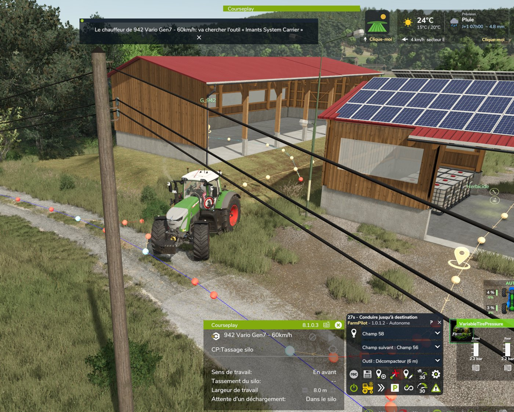

# FarmPilot (FS25)

**FR** · [EN](#english) · [Discord](https://discord.gg/yrFBwCgtA7) · [Téléchargement / Download](../../releases/latest)

**FarmPilot est un mod autonome : il fait tourner la ferme tout seul.** Vous dites quel champ travailler, avec quel outil et quel champ ensuite, et FarmPilot enchaîne : il va chercher l'outil, l'attelle, roule jusqu'au champ, travaille, refait le plein, revient, range l'outil à sa place et passe au champ suivant. Vous gérez la ferme, il fait le travail.

FarmPilot est basé sur **AutoDrive 3.0.1.4** de Stephan Schlosser et de l'équipe AutoDrive (licence MIT, avis d'origine dans [LICENSE-AutoDrive-MIT.txt](LICENSE-AutoDrive-MIT.txt)). Merci à toute l'équipe AutoDrive.

FarmPilot est publié sous licence **GNU GPL v3** (voir [LICENSE](LICENSE)). Fichiers modifiés et ajoutés par rapport à AutoDrive : [CHANGES.md](CHANGES.md). Licences et crédits : [NOTICE.md](NOTICE.md), [credits.txt](credits.txt).

### Mode Autonome : la ferme qui travaille seule
- **Du hangar au champ, sans vous** : il va chercher l'outil choisi (marche arrière, attelage, flexibles et prise de force), roule jusqu'au champ et lance le parcours Courseplay du champ à la bonne largeur.
- **Enchaînement des champs** : champ suivant et outil suivant dans le HUD. À la fin d'un champ, l'outil est reposé à sa place de parking, le tracteur prend l'outil suivant et part au champ suivant.
- **Semoirs** : culture de saison et zone de plein réglées par champ ; plein au départ, et quand le semoir est vide il sort, refait le plein (palettes, big bags, silos), revient et reprend au dernier point.
- **Épandeurs et pulvés** : produit, quantité « Plein » ou « Juste ce qu'il faut » et zone de plein ; le reste est gardé pour le champ suivant s'il prend le même produit, sinon vidé en big bags / IBC.
- **Presse à balles** : suit au champ le tracé de la moissonneuse ou de l'andaineur passé avant.
- **Remorque à balles** : ramasse les balles (toutes, enrubannées ou non), les dépose à la zone choisie (vente ou stockage) et revient tant qu'il en reste.
- **Bennes** : une benne de la ferme est attelée au départ et reposée à sa place à la fin ; échange de bennes à la livraison.
- **Moissonneuses et ensileuses** : les bennes attendent en file au bord du champ sur le sol récolté, restent sous la goulotte pendant le déchargement et ne roulent jamais dans la culture debout ; l'ensileuse est suivie par derrière, demi-tours compris.
- **Bouton parking** : chaque outil attelé est posé à sa place, l'épandeur vidé, puis le tracteur se gare.

### Un chauffeur qui conduit comme vous
- Croisement face à face : l'un se range, l'autre recule ; règles de circulation sur les chemins.
- Contourne les obstacles, les poteaux et les piquets ; manœuvre avant / arrière quand c'est trop serré.
- Virages au vrai rayon de l'attelage, vitesse adaptée, clignotants à la bonne distance.
- Routes secondaires et tertiaires : prises seulement si elles font gagner du temps.
- Attend que les outils soient repliés avant de partir ; sort du champ sans passer dans la culture.
- Files d'attente et pont-bascule sans dépassement.

### Tout l'ancien AutoDrive Addon intégré
Pont-bascule, clignotant avant les virages, délai de coupure moteur, feux moteur coupé, outil arrière, « silo vide » réglable par véhicule (un camion peut attendre en bord de champ d'être rempli). Désactivez FS25_AutoDriveAddon si vous l'aviez.

Sans Courseplay, FarmPilot reste un AutoDrive complet (livraisons, chargement, déchargement des moissonneuses) ; le mode Autonome attend ou laisse la main à l'ouvrier du jeu, au choix.

Le détail complet est dans le [CHANGELOG](CHANGELOG.md).

### Installation
1. Téléchargez `FS25_FarmPilot.zip` dans les [Releases](../../releases) et posez-le dans votre dossier `mods`, sans le renommer.
2. FarmPilot remplace AutoDrive : si AutoDrive est aussi activé, FarmPilot le désactive et affiche un message. Retirez alors FS25_AutoDrive de vos mods.

### Vous jouez déjà avec AutoDrive ?
Remplacez simplement AutoDrive par FarmPilot dans votre partie. FarmPilot reprend :
- le réseau de routes de la partie (`AutoDrive_config.xml`) ;
- le dossier `modSettings/FS25_AutoDrive` (routes enregistrées, couleurs) ;
- les réglages de vos véhicules.

Pour une nouvelle installation ou une nouvelle partie, tout est enregistré sous le nom FarmPilot (`FarmPilot_config.xml`, `modSettings/FS25_FarmPilot`).

Les mods qui déclarent AutoDrive comme mod requis (par exemple certains carrefours posables, ou les anciennes versions d'AutoDrive Addon) peuvent refuser de se charger sans AutoDrive.

---

## English

[Discord](https://discord.gg/yrFBwCgtA7) · [Download](../../releases/latest)

**FarmPilot is an autonomous mod: it runs the farm on its own.** Tell it which field to work, with which tool and which field comes next, and FarmPilot chains it all: it fetches the tool, hitches it, drives to the field, works it, refills, comes back, parks the tool at its spot and moves on to the next field. You manage the farm, it does the work.

FarmPilot is based on **AutoDrive 3.0.1.4** by Stephan Schlosser and the AutoDrive team (MIT licence, original notice in [LICENSE-AutoDrive-MIT.txt](LICENSE-AutoDrive-MIT.txt)). Many thanks to the whole AutoDrive team.

FarmPilot is released under the **GNU GPL v3** (see [LICENSE](LICENSE)). Files changed and added compared with AutoDrive: [CHANGES.md](CHANGES.md). Licences and credits: [NOTICE.md](NOTICE.md), [credits.txt](credits.txt).

### Autonomous mode: a farm that works by itself
- **From the shed to the field, without you**: fetches the chosen tool (reversing, hitching, hoses and PTO), drives to the field and starts the field's Courseplay course at the right width.
- **Field after field**: next field and next tool in the HUD. At the end of a field the tool is parked at its spot, the tractor takes the next tool and leaves for the next field.
- **Seeders**: in-season crop and refill zone set per field; fills up before leaving, and when empty it leaves the field, refills (pallets, big bags, silos), comes back and resumes at the last point.
- **Spreaders and sprayers**: product, "Full" or "Just enough" quantity and refill zone; leftovers are kept if the next field uses the same product, otherwise emptied into big bags / IBCs.
- **Baler**: follows the track of the combine or windrower that went before.
- **Bale trailer**: collects bales (all, wrapped or unwrapped), drops them at the chosen zone (sale or storage) and comes back while some are left.
- **Trailers**: a farm trailer is hitched at the start and parked back at its spot at the end; trailer swap at delivery.
- **Combines and forage harvesters**: unloaders queue at the field edge on harvested ground, stay under the pipe while unloading and never drive into standing crop; the forage harvester is followed from behind, headland turns included.
- **Parking button**: every attached tool is parked at its spot, the spreader emptied, then the tractor parks.

### A driver that drives like you
- Head-on passing: one pulls over, the other reverses; traffic rules on tracks.
- Drives around obstacles, posts and poles; forward / reverse manoeuvre when it is too tight.
- Corners at the real radius of the combination, adapted speed, indicators at the right distance.
- Secondary and tertiary roads: only used when they save time.
- Waits for tools to fold before leaving; leaves the field without driving through the crop.
- Queues and weighbridge without overtaking.

### The whole former AutoDrive Addon built in
Weighbridge, indicator before turns, engine stop delay, lights with the engine off, rear implement, per-vehicle "empty silo" timer (a truck can wait at the field edge to be filled). Disable FS25_AutoDriveAddon if you had it.

Without Courseplay, FarmPilot is still a complete AutoDrive (deliveries, loading, unloading combines); Autonomous mode waits or hands over to the game worker, your choice.

Full details are in the [CHANGELOG](CHANGELOG.md).

### Installation
1. Download `FS25_FarmPilot.zip` from the [Releases](../../releases) and put it in your `mods` folder, without renaming it.
2. FarmPilot replaces AutoDrive: if AutoDrive is also active, FarmPilot disables it and shows a message. Then remove FS25_AutoDrive from your mods.

### Already playing with AutoDrive?
Just replace AutoDrive with FarmPilot in your savegame. FarmPilot reuses:
- the savegame's road network (`AutoDrive_config.xml`);
- the `modSettings/FS25_AutoDrive` folder (saved routes, colours);
- your vehicle settings.

For a new install or a new savegame, everything is saved under the FarmPilot name (`FarmPilot_config.xml`, `modSettings/FS25_FarmPilot`).

Mods that list AutoDrive as a required mod (for example some placeable crossings) may refuse to load without AutoDrive.

---

Traductions / Translations : merci à huseyinsayar (Türkçe).
