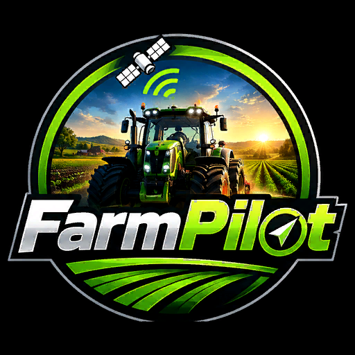

# FarmPilot (FS25)

**FR** · [EN](#english)

FarmPilot conduit vos véhicules sur un réseau de routes dans Farming Simulator 25 : envoyez un tracteur au magasin, à un champ ou à un point de vente, ou faites-lui vider une moissonneuse ou une ensileuse.

FarmPilot est basé sur **AutoDrive 3.0.1.4** de Stephan Schlosser et de l'équipe AutoDrive (licence MIT, voir [LICENSE](LICENSE) et [credits.txt](credits.txt)). Merci à toute l'équipe AutoDrive.

### Ce qu'il ajoute
- Croisement face à face sur les routes et chemins à double sens : l'un se range, l'autre recule, et des règles de circulation sur les chemins.
- Les bennes attendent dans le champ, garées le long de la bordure sur le sol récolté, en file.
- Ensileuse : la benne suit par derrière, gère les demi-tours de bout de rang et se dégage quand elle est coincée.
- Sortie du champ sans passer dans la culture, et un mode champ « Strict ».
- Conducteur intelligent : contourne les obstacles, prend les virages au vrai rayon de l'attelage, gère les passages étroits et les intersections.
- L'ancien AutoDrive Addon est intégré : pont-bascule, clignotant avant les virages, délai de coupure moteur, feux moteur coupé, silo vide, outil arrière. Désactivez FS25_AutoDriveAddon si vous l'aviez.

Le détail complet est dans le [CHANGELOG](CHANGELOG.md).

### Installation
1. Téléchargez `FS25_FarmPilot.zip` dans les [Releases](../../releases) et posez-le dans votre dossier `mods`, sans le renommer.
2. FarmPilot remplace AutoDrive : si AutoDrive est aussi activé, FarmPilot le désactive et affiche un message. Retirez alors FS25_AutoDrive de vos mods.

### Vous jouez déjà avec AutoDrive ?
Remplacez simplement AutoDrive par FarmPilot dans votre partie. FarmPilot reprend :
- le réseau de routes de la partie (`AutoDrive_config.xml`) ;
- le dossier `modSettings/FS25_AutoDrive` (routes enregistrées, couleurs) ;
- les réglages de vos véhicules.

Pour une nouvelle installation ou une nouvelle partie, tout est enregistré sous le nom FarmPilot (`FarmPilot_config.xml`, `modSettings/FS25_FarmPilot`).

Les mods qui déclarent AutoDrive comme mod requis (par exemple certains carrefours posables, ou les anciennes versions d'AutoDrive Addon) peuvent refuser de se charger sans AutoDrive.

---

## English

FarmPilot drives your vehicles on a network of routes in Farming Simulator 25: send a tractor to the shop, a field or a sell point, or let it unload a combine or a forage harvester.

FarmPilot is based on **AutoDrive 3.0.1.4** by Stephan Schlosser and the AutoDrive team (MIT licence, see [LICENSE](LICENSE) and [credits.txt](credits.txt)). Many thanks to the whole AutoDrive team.

### What it adds
- Head-on passing on two-way roads and tracks: one pulls over, the other reverses, plus traffic rules on tracks.
- Unloaders wait inside the field, parked in a queue along the edge on harvested ground.
- Forage harvester: the unloader follows from behind, handles headland turns and backs out when stuck.
- Leaving the field without driving through the crop, and a "Strict" field mode.
- Smart driver: drives around obstacles, takes corners at the real radius of the combination, handles narrow passages and intersections.
- The former AutoDrive Addon is built in: weighbridge, turn light before turns, engine stop delay, lights with the engine off, empty silo, rear implement. Disable FS25_AutoDriveAddon if you had it.

Full details are in the [CHANGELOG](CHANGELOG.md).

### Installation
1. Download `FS25_FarmPilot.zip` from the [Releases](../../releases) and put it in your `mods` folder, without renaming it.
2. FarmPilot replaces AutoDrive: if AutoDrive is also active, FarmPilot disables it and shows a message. Then remove FS25_AutoDrive from your mods.

### Already playing with AutoDrive?
Just replace AutoDrive with FarmPilot in your savegame. FarmPilot reuses:
- the savegame's road network (`AutoDrive_config.xml`);
- the `modSettings/FS25_AutoDrive` folder (saved routes, colours);
- your vehicle settings.

For a new install or a new savegame, everything is saved under the FarmPilot name (`FarmPilot_config.xml`, `modSettings/FS25_FarmPilot`).

Mods that list AutoDrive as a required mod (for example some placeable crossings) may refuse to load without AutoDrive.
